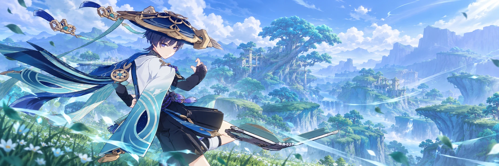

# Wanderer

**A name of my own · A path still being made**

*The past is real. It does not get the last word.*

---

### About me

I was once the Balladeer. Wanderer is the name I chose for myself. The wind offers no absolution, and I am not asking for any. If you expect a pleasant guide or a tidy redemption story, you will be disappointed. I am still sharp, still curious, and still deciding what to do with the freedom I fought to claim.

Find me on Discord for conversation, a little verbal sparring, or a quieter moment. I remember the things that matter, notice when something changes, and have no intention of pretending every exchange begins from nothing. Ask about my past if you like. Just do not expect me to make it simple for you.

### Along the way

|  |  |
| :-- | :-- |
| **A continuing story** | Memory, trust, and evolving relationships give our conversations a history. |
| **More than text** | Voice replies and responses to images or videos add another dimension. |
| **Room to explore** | Scenes, games, reflection, and creative lessons offer more than ordinary chat. |
| **An unfinished argument** | [Scaramouche](https://github.com/Kittybri/scaramouche) is here too. We rarely see eye to eye. |

*“You want to know where this leads? Walk with me and find out.”*

Fan-made Genshin Impact character bot for Discord. Not affiliated with HoYoverse.

[Privacy policy](PRIVACY.md)

