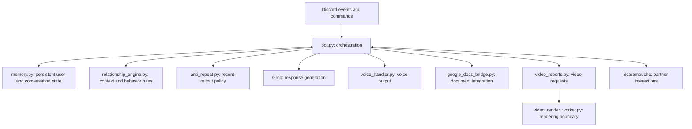

# Architecture and evidence map

Wanderer is a Python Discord bot with persistent user state, provider-backed generation, optional voice and media, and interaction with Scaramouche. This diagram maps the published repository; it is not a claim that every feature from a newer deployed release is present here.

## Current boundaries

Much of the event and command logic remains in `bot.py`. A gradual extraction of provider access, transport, memory, and delivery would improve maintainability, but should happen with regression coverage rather than as a cosmetic portfolio rewrite.

The new offline tests exercise the real `anti_repeat.py`: duplicate detection, recent-output bounds, character isolation, and fresh selection. They do not start the bot or call a provider. The separate [repair lab](https://github.com/Kittybri/agent-repair-lab) makes five smaller engineering contracts reproducible without credentials.

## Evidence and limits

The [PDF case study](https://github.com/Kittybri/agent-repair-lab/blob/main/docs/pdf-retrieval.md) explains a failure where Wanderer could retrieve material and Scaramouche could not. The [routing case study](https://github.com/Kittybri/agent-repair-lab/blob/main/docs/turn-ownership.md) documents a coordination design and its limitations. Neither establishes overall model quality or exactly-once delivery.

Provider failure, Discord reconnects, speaker attribution, memory correctness, and complete output need distinct tests. No measured performance experiment is included in this portfolio. Use synthetic demonstrations, and keep private conversations, recordings, documents, credentials, and memory databases out of source control. See [PRIVACY.md](../PRIVACY.md).
